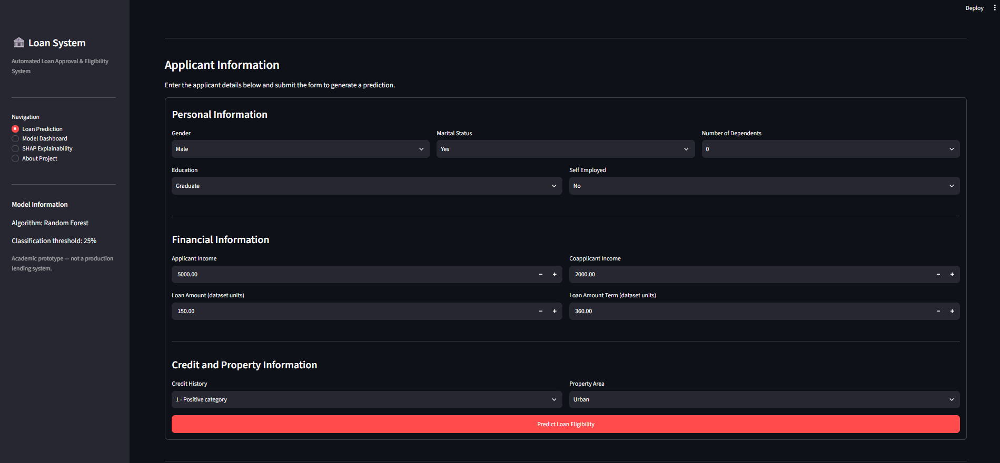
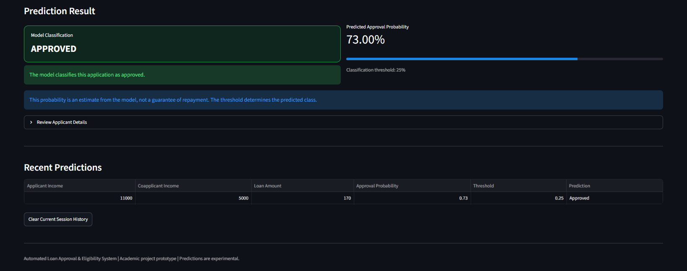
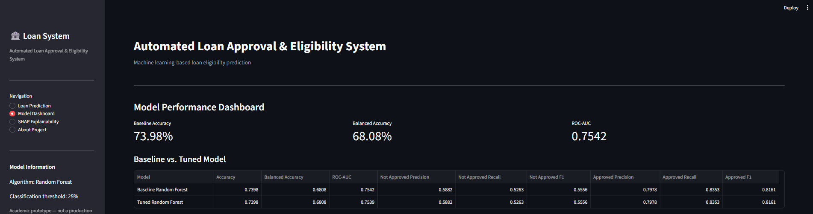
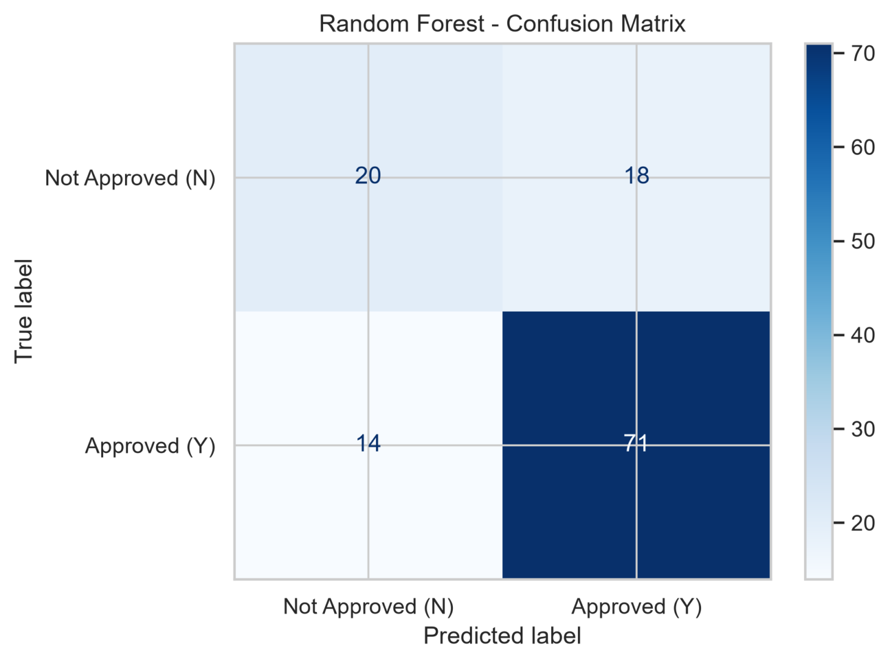
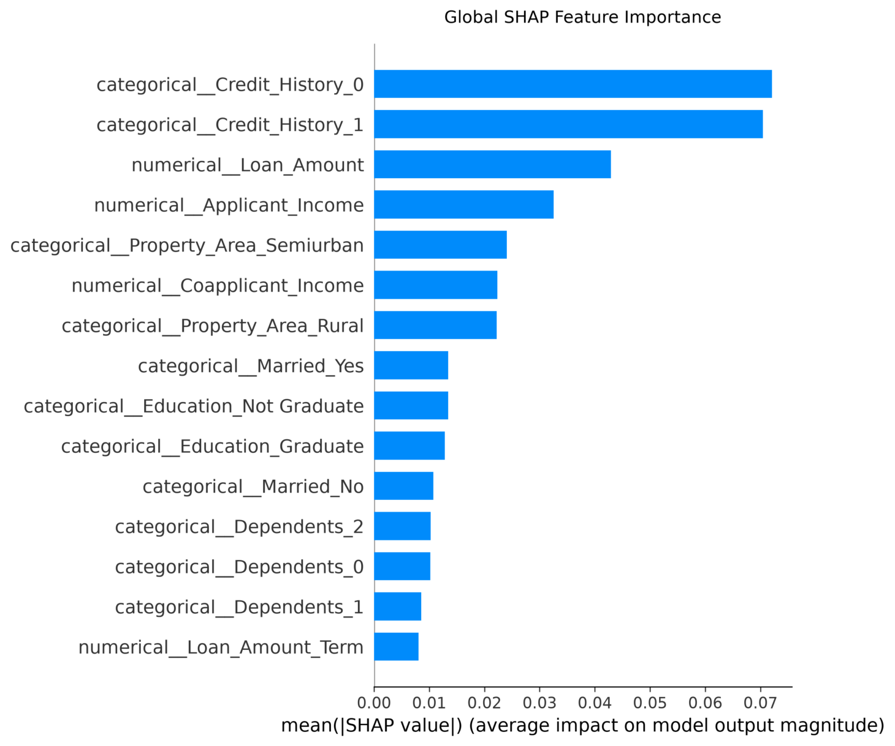
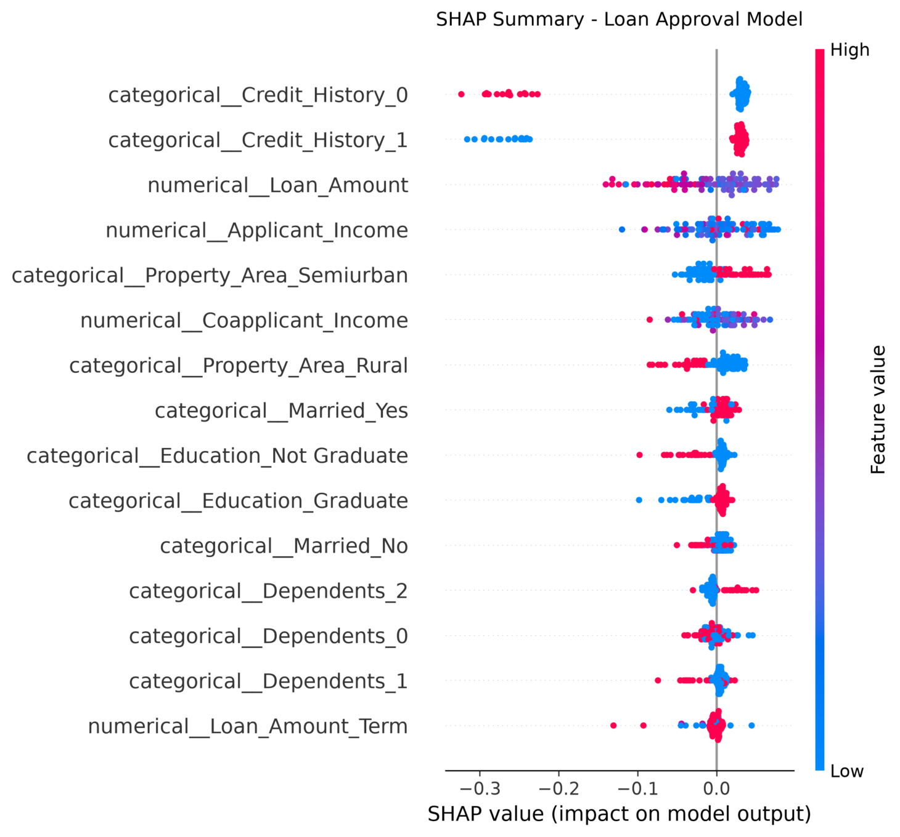
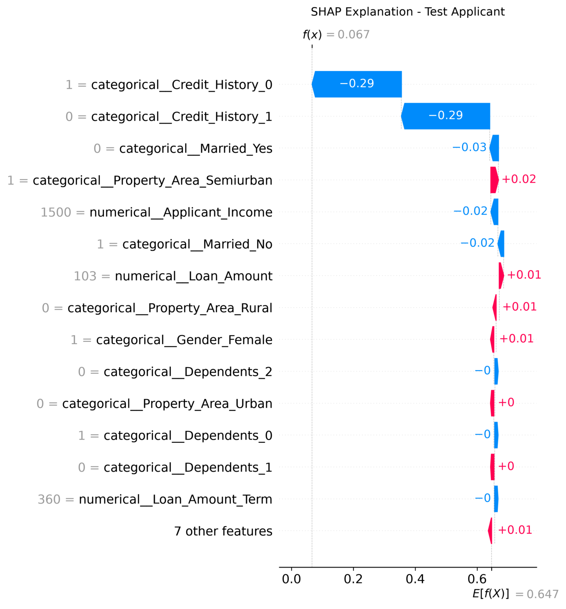

# Automated Loan Approval & Eligibility System

A machine learning-based application that predicts loan eligibility using a **Random Forest Classifier**. The project integrates data preprocessing, model training, hyperparameter tuning, classification-threshold optimization, model evaluation, and SHAP-based explainability. A **Streamlit web interface** allows users to enter applicant information, generate loan eligibility predictions, and explore model performance.

> **Disclaimer:** This project is an academic machine learning prototype. Its predictions are not financial advice and must not be used as the sole basis for real lending decisions.

---

## Features

- **Loan Eligibility Prediction:** Enter applicant details and receive a predicted loan eligibility classification.
- **Prediction Probability:** View the estimated approval probability and applied classification threshold.
- **Model Dashboard:** Explore model evaluation metrics, performance comparisons, and feature importance visualizations.
- **SHAP Explainability:** Understand global feature importance and individual prediction contributions.
- **Data Preprocessing:** Handle missing values, encode categorical features, and prepare datasets for model training.
- **Model Development:** Train and tune a Random Forest classifier.
- **Threshold Optimization:** Evaluate classification thresholds and apply a saved threshold during prediction.
- **Prediction History:** View recent predictions generated during the current application session.

## Technology Stack

| Area | Technologies |
|---|---|
| Programming Language | Python |
| User Interface | Streamlit |
| Data Manipulation | Pandas, NumPy |
| Machine Learning | Scikit-learn, Random Forest |
| Model Explainability | SHAP |
| Data Visualization | Matplotlib, Seaborn |
| Model Persistence | Joblib |
| Version Control | Git, GitHub |

## Project Structure

```text
Automated-Loan-Approval-System/
│
├── app.py
│
├── assets/
│   └── images/
│       ├── loan-prediction-interface.png
│       ├── prediction-result.png
│       ├── model-performance-dashboard.png
│       ├── confusion-matrix.png
│       ├── shap-feature-importance.png
│       ├── shap-summary-plot.png
│       └── shap-individual-applicant.png
│
├── data/
│   └── raw/
│       └── eda.py
│
├── models/
│   ├── approval_threshold.joblib
│   ├── feature_names.joblib
│   ├── preprocessor.joblib
│   ├── random_forest_model.joblib
│   ├── tuned_random_forest_model.joblib
│   └── threshold_optimized_random_forest_model.joblib
│
├── reports/
│   ├── confusion_matrix.png
│   ├── roc_curve.png
│   ├── feature_importance.png
│   ├── shap_summary.png
│   ├── shap_importance.png
│   └── ... evaluation reports and plots
│
├── src/
│   ├── preprocessing.py
│   ├── train_model.py
│   ├── model_tuning.py
│   ├── threshold_optimization.py
│   ├── predict_loan.py
│   ├── explainability.py
│   └── __init__.py
│
├── .gitignore
├── requirements.txt
└── README.md
```

## Dataset

The project uses the **Loan Eligibility Prediction** dataset.

- **Number of Records:** 614
- **Number of Columns:** 13
- **Target Column:** `Loan_Status`
- **Target Values:** `Y` (Approved) and `N` (Not Approved)

The `Customer_ID` column is excluded from model training. The remaining applicant information is used as input features.

### Dataset Source

The dataset was published by **AVINESH Prabhakaran** on Kaggle.

**Original Dataset:**  
https://www.kaggle.com/competitions/loan-eligibility-prediction/data

### Dataset License

**Creative Commons Attribution-NonCommercial 4.0 International (CC BY-NC 4.0)**

https://creativecommons.org/licenses/by-nc/4.0/

The dataset is used for academic and non-commercial machine learning purposes.

The original dataset and processed dataset files are not included in this repository. Please obtain the dataset from its original Kaggle source and comply with the applicable licence and competition rules.

Credit goes to the original dataset creator, AVINESH Prabhakaran.

## Machine Learning Workflow

1. **Exploratory Data Analysis:** Inspect the dataset, feature distributions, missing values, and potential outliers.
2. **Preprocessing:** Separate features and target, handle missing values, encode categorical variables, and split the data into training and testing sets.
3. **Model Training:** Train a Random Forest classifier using the prepared training data.
4. **Model Tuning:** Perform hyperparameter tuning to explore different Random Forest configurations.
5. **Threshold Optimization:** Evaluate classification thresholds and save the selected threshold for prediction.
6. **Model Evaluation:** Evaluate classification performance using accuracy, balanced accuracy, ROC-AUC, classification reports, and confusion matrices.
7. **Explainability:** Apply SHAP to understand global feature importance and individual prediction contributions.
8. **Application Integration:** Load the saved model artifacts into Streamlit and generate predictions from applicant information.

---

## Application Screenshots

### 1. Loan Prediction Interface

The application provides an interactive interface where users can enter applicant details, including personal, financial, credit, and property information.



### 2. Loan Prediction Result

Displays the predicted loan eligibility classification, estimated approval probability, applied classification threshold, and recent prediction history.



### 3. Model Performance Dashboard

Displays model evaluation metrics, baseline versus tuned model comparison, and feature importance visualization.



---

## Model Evaluation

The Random Forest classifier is evaluated using a separate test dataset to measure its classification performance.

### Confusion Matrix

The confusion matrix illustrates the number of correctly and incorrectly classified applicants for both approved and not-approved loan categories.



The evaluation results help identify how effectively the model distinguishes between approved and not-approved loan applications.

---

## SHAP Explainability

**SHAP (SHapley Additive exPlanations)** is used to interpret the machine learning model by identifying how different applicant features contribute to its predictions.

### 1. Global SHAP Feature Importance

Displays the mean absolute SHAP values to identify the features with the greatest average influence on model output.



### 2. SHAP Summary Plot

Illustrates the distribution and direction of feature contributions across test applicants. It helps understand how different feature values influence model predictions.



### 3. Individual Applicant Explanation

Provides a local explanation of a specific test applicant's prediction by showing how individual features contribute to the model output.



---

## Installation and Setup

Follow these steps to run the project locally.

### 1. Clone the Repository

```bash
git clone https://github.com/NirmalThirumal/Automated-Loan-Approval-System.git
```

### 2. Navigate to the Project Directory

```bash
cd Automated-Loan-Approval-System
```

### 3. Create a Virtual Environment

```bash
python -m venv .venv
```

### 4. Activate the Virtual Environment

**Windows PowerShell:**

```powershell
.\.venv\Scripts\Activate.ps1
```

If PowerShell blocks script execution, you can use Command Prompt instead:

```cmd
.venv\Scripts\activate.bat
```

### 5. Install Dependencies

Upgrade pip and install the required Python packages:

```bash
python -m pip install --upgrade pip
python -m pip install -r requirements.txt
```

### 6. Run the Streamlit Application

```bash
streamlit run app.py
```

The application should open in your browser. If it does not, open the local URL displayed in the terminal, usually:

```text
http://localhost:8501
```

---

## Required Model Files

The Streamlit application uses the following saved artifacts from the `models/` directory:

- `threshold_optimized_random_forest_model.joblib`
- `preprocessor.joblib`
- `approval_threshold.joblib`

Additional model artifacts, including the baseline and tuned Random Forest models, are also included for model development and evaluation.

Make sure the required model files are present before starting the application. The repository includes the trained artifacts, allowing the application to run without retraining the model.

## Model Evaluation and Reports

The `reports/` directory contains generated model evaluation outputs, including:

- Confusion matrices
- ROC curves
- Feature importance visualizations
- SHAP summary plots
- SHAP feature importance results
- Individual SHAP explanations
- Hyperparameter tuning results
- Classification threshold optimization results
- Model comparison reports

Results may vary if the model is retrained using different configurations, data splits, or random seeds. Refer to the saved reports and model artifacts for the results associated with the committed project version.

## Limitations

- Predictions depend on the quality and representativeness of the training dataset.
- The dataset may not represent current lending policies or all applicant populations.
- Model predictions can contain errors and may reflect biases in historical data.
- SHAP explanations describe model behavior; they do not establish that a prediction is fair or correct.
- The classification threshold affects the final predicted class.
- This prototype does not connect to a bank, credit bureau, or live loan-processing system.
- The application is intended for academic demonstration and experimentation, not real-world lending decisions.

## Future Improvements

- Add automated unit and integration tests.
- Improve input validation and error handling.
- Evaluate model fairness and performance across relevant applicant groups.
- Deploy the application using a suitable hosting platform.
- Implement model monitoring and retraining workflows.
- Explore additional classification algorithms and compare their performance.

## Author

**Nirmal T**  
B.Tech, Computer Science and Engineering  
Puducherry Technological University

---

If you find this project useful, feel free to ⭐ star the repository.
